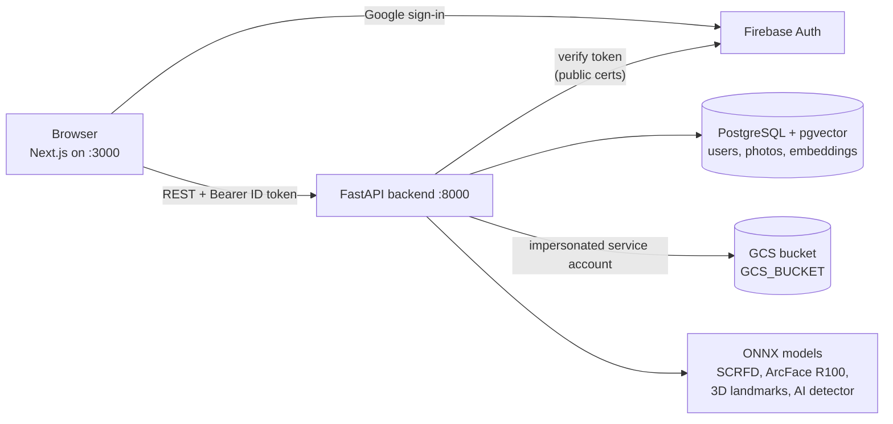
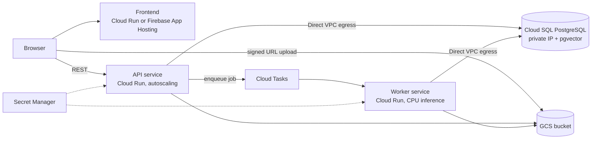

# Face App

A face recognition web app. Users sign in with Google, enroll their face with four guided photos, and then recognize people in batches of photos. Every image is checked for AI generation before any face is processed, admins can review everything stored, and all images live in a private Google Cloud Storage bucket.

- **Frontend:** Next.js 16 + Firebase Auth (`frontend/`)
- **Backend:** FastAPI + InsightFace/ONNX Runtime on CPU (`src/`)
- **Storage:** PostgreSQL + pgvector for users, photo catalog and embeddings; GCS for images and results

## Features

- **Sign in with Google** (Firebase Auth). The backend verifies the Firebase ID token on every request.
- **Mandatory face enrollment.** On first sign-in a user must register four photos (close frontal, far frontal, left and right profile) before anything else in the app is available. The backend checks pose, distance, identity consistency, AI generation and duplicates before storing anything.
- **Batch recognition.** Upload or capture up to 10 photos; each one is processed independently and every detected face is boxed and labeled with the matching user's name, or as unknown.
- **AI-generated image detection.** Images that carry AI provenance metadata (C2PA/IPTC, Stable Diffusion, ComfyUI) or that a forensic classifier flags are marked as AI-generated and skipped by face detection, both in recognition and in enrollment.
- **Roles.** `user` uploads and recognizes; `admin` also gets an administration panel to browse every user's photos and results, change roles and delete photos or face registrations.

## Architecture



Prediction and enrollment run as asynchronous jobs: the API answers `202` with a `job_id` and the client polls `GET /status/{job_id}`. Jobs run in a thread pool (`MAX_WORKERS`) so the API stays responsive while photos are processed.

## Repository layout

```text
face-app/
├── .env.example                   # Project variables (GCP project, bucket, Firebase, admins)
├── frontend/                      # Next.js app (login, enrollment, recognition, admin)
│   ├── src/app/                   # Routes: /login, /registro, / (recognition), /admin
│   ├── src/components/            # Session gate, camera/file input, detection canvas, admin view
│   ├── src/lib/                   # Backend client (adds the ID token) and Firebase init
│   ├── next.config.ts             # Maps the project variables to the browser bundle
│   └── Dockerfile                 # Standalone production build
├── src/                           # FastAPI backend (mounted into the container)
│   ├── app/main.py                # App, CORS, /health
│   └── lib/
│       ├── api.py                 # REST endpoints, roles, jobs
│       ├── auth.py                # Firebase ID token verification
│       ├── config.py              # Settings from environment variables and .env
│       ├── schemas.py
│       ├── services/
│       │   ├── face_service.py    # Detection, alignment, embeddings, enrollment rules, identification
│       │   ├── ai_detector.py     # AI-generated image detection
│       │   └── task_manager.py    # In-memory async jobs
│       └── storage/
│           ├── app_db.py          # users and photos tables
│           ├── blob_store.py      # GCS bucket (or local folder) for images and results
│           ├── pgvector_store.py  # Embeddings in PostgreSQL
│           └── embedding_store.py # Embeddings in a JSON file (alternative)
├── models/                        # ONNX models (not versioned, see download_models.sh)
├── scripts/migrate_local_to_gcs.py  # One-off migration of a local output/ folder to GCS
├── download_models.sh
├── docker-compose.yml             # backend, postgres, frontend
├── Dockerfile                     # Backend image
├── .env.docker.example            # Backend settings used by Docker Compose
└── .env.local.example             # Backend settings for running without Docker
```

## Models

`./download_models.sh` downloads everything into `models/` and symlinks it into `src/models/` for local runs.

| File | Role | Source |
|---|---|---|
| `scrfd_10g_bnkps.onnx` | Face detector with 5 landmarks (SCRFD-10GF) | InsightFace `antelopev2` pack |
| `glintr100.onnx` | Face embeddings, 512-d (ArcFace ResNet100 trained on Glint360K) | InsightFace `antelopev2` pack |
| `1k3d68.onnx` | 3D landmarks, used to estimate head pose during enrollment | InsightFace `antelopev2` pack |
| `community_forensics_vit_s384.onnx` | AI-generated image classifier (ViT-S/16, 384 px) | [Community Forensics](https://huggingface.co/papers/2411.04125) (CVPR 2025), ONNX re-upload on Hugging Face pinned to a commit and checked by SHA-256 |

**Licenses:** InsightFace's pretrained models are for non-commercial research use only. The AI detector's re-upload is tagged MIT, but the original authors' license is unconfirmed and its training data is CC-BY-4.0 for research, so treat it as non-commercial too.

## Project variables

Nothing project-specific is committed. The Google Cloud project, bucket, service account, admins and Firebase web config are plain environment variables, and both the backend and the frontend read them:

| Variable | Required | Used by | Description |
|---|---|---|---|
| `GCP_PROJECT_ID` | yes | backend, frontend | Google Cloud project hosting Firebase Auth and the bucket |
| `GCS_BUCKET` | with `STORAGE_BACKEND=gcs` | backend | Private bucket for images and results |
| `GCS_SERVICE_ACCOUNT` | recommended | backend | Service account to impersonate for bucket access; empty uses your credentials directly |
| `ADMIN_EMAILS` | recommended | backend | Comma-separated emails that are always admins (must be verified) |
| `FIREBASE_API_KEY` | yes | frontend | Firebase web app API key |
| `FIREBASE_APP_ID` | yes | frontend | Firebase web app ID |
| `FIREBASE_PROJECT_ID` | no | backend, frontend | Firebase project, if different from `GCP_PROJECT_ID` (e.g. `demo-…` with the emulator) |
| `FIREBASE_AUTH_DOMAIN` | no | frontend | Defaults to `<project>.firebaseapp.com` |
| `BACKEND_PUBLIC_URL` | no | frontend | Backend URL as seen by the browser; defaults to `http://localhost:8000` |
| `FIREBASE_AUTH_EMULATOR_HOST` | dev only | backend, frontend | Use the Firebase Auth emulator (see below). Never set it on a real backend |

**How to provide them.** Either export them in your shell or put them in a root `.env` file, which is git-ignored:

```bash
cp .env.example .env   # and fill it in
```

- **Docker Compose** reads `./.env` automatically. Exported shell variables take precedence over it. The backend container receives them through `environment:`, and the frontend image receives them as build args.
- **Without Docker,** load them into the shell before starting the backend or the frontend:

  ```bash
  set -a; . ./.env; set +a
  ```

- **Frontend only:** `next.config.ts` maps these variables to the `NEXT_PUBLIC_*` values compiled into the browser bundle, and `next build` fails if `GCP_PROJECT_ID`, `FIREBASE_API_KEY` or `FIREBASE_APP_ID` is missing. They are fixed at build time, so rebuild the frontend after changing them. As an alternative to exporting, you can put them in `frontend/.env.local` (see `frontend/.env.example`).
- **Backend only:** these variables win over the backend's `.env` file, which holds the remaining non-project settings (see [Backend settings](#backend-settings)).

The Firebase web config is public by design: access control is enforced by the backend.

## Google Cloud and Firebase setup

One-time setup of a project for the app. It uses the variables above, so export `GCP_PROJECT_ID` and `GCS_BUCKET` first.

```bash
export GCP_PROJECT_ID=my-project GCS_BUCKET=my-face-app-images

# 1. Private bucket for images and results
gcloud storage buckets create "gs://$GCS_BUCKET" --project "$GCP_PROJECT_ID" \
    --location US --uniform-bucket-level-access --public-access-prevention

# 2. Service account that can only read and write objects in that bucket
gcloud iam service-accounts create face-app --project "$GCP_PROJECT_ID" --display-name "face-app backend"
export GCS_SERVICE_ACCOUNT="face-app@$GCP_PROJECT_ID.iam.gserviceaccount.com"
gcloud storage buckets add-iam-policy-binding "gs://$GCS_BUCKET" \
    --member "serviceAccount:$GCS_SERVICE_ACCOUNT" --role roles/storage.objectUser

# 3. Let each developer who runs the backend impersonate it
gcloud iam service-accounts add-iam-policy-binding "$GCS_SERVICE_ACCOUNT" --project "$GCP_PROJECT_ID" \
    --member "user:$(gcloud config get-value account)" --role roles/iam.serviceAccountTokenCreator

# 4. Firebase web app (add Firebase to the project first if needed: firebase projects:addfirebase "$GCP_PROJECT_ID")
firebase apps:create WEB face-app --project "$GCP_PROJECT_ID"
firebase apps:sdkconfig WEB <APP_ID> --project "$GCP_PROJECT_ID"   # -> FIREBASE_API_KEY, FIREBASE_APP_ID
```

Then, in the Firebase console, enable **Google** under *Authentication → Sign-in method*. `localhost` is an authorized domain by default; add your production domain there when you deploy.

**Notes:**

- IAM changes can take a few minutes to propagate.
- New buckets keep deleted objects for 7 days (soft delete), so photos deleted from the app can be restored during that time.
- The service account has no `storage.buckets.get` permission on purpose; the backend never needs it.

## Getting started (Docker)

### Prerequisites

- Docker with Compose.
- A Google Cloud project set up as above, and the [project variables](#project-variables) in `./.env` or exported.
- `gcloud auth application-default login`: the backend container mounts these credentials read-only and uses them only to impersonate `GCS_SERVICE_ACCOUNT`.

### Steps

```bash
./download_models.sh          # ONNX models (~500 MB)
cp .env.example .env          # fill in the project variables
docker compose build
docker compose up -d
```

Open http://localhost:3000. The API is on http://localhost:8000 (Swagger at `/docs`).

The backend container mounts `src/` and reloads on code changes. Two files are mounted as single files, so changes to them only apply after recreating the container (`docker compose up -d --force-recreate backend`): `.env.docker.example`, if your editor replaces the file when saving, and `~/.config/gcloud/application_default_credentials.json` after running `gcloud auth application-default login` again. After changing the project variables, recreate the backend and rebuild the frontend (`docker compose up -d --build`).

## Local development (without Docker)

**Database:** `docker compose up postgres -d`

**Project variables** (in every terminal): `set -a; . ./.env; set +a`

**Backend** (Python 3.12):

```bash
uv venv --python 3.12 .venv && source .venv/bin/activate
uv pip install -r requirements.txt
cd src
cp ../.env.local.example .env        # POSTGRES_HOST=localhost, MODEL_PATH=models (symlinks)
uvicorn app.main:app --reload --port 8000
```

Without Docker the backend uses your Application Default Credentials directly, still impersonating `GCS_SERVICE_ACCOUNT`. Set `STORAGE_BACKEND=local` to keep images in `OUTPUT_PATH` instead of a bucket.

**Frontend** (Node.js 24):

```bash
cd frontend
npm install
npm run dev                          # http://localhost:3000
```

### Developing without real Google accounts

If your Firebase project is shared with other apps, use the Auth emulator for tests instead of creating users there. The emulator needs Java 21.

```bash
firebase emulators:start --only auth --project demo-face-app
```

Then start the backend and the frontend with:

```bash
export FIREBASE_AUTH_EMULATOR_HOST=127.0.0.1:9099 FIREBASE_PROJECT_ID=demo-face-app
```

To keep test data apart, point the backend at another database and set `STORAGE_PREFIX=dev/` (or `STORAGE_BACKEND=local`).

> **Never set `FIREBASE_AUTH_EMULATOR_HOST` on a real backend**: with it, the backend accepts unsigned tokens. Docker Compose deliberately does not pass it to the containers.

## Backend settings

These are in `.env.docker.example` (Docker) and `.env.local.example` (copied to `src/.env` for local runs). None of them is project-specific.

| Variable | Default (Docker) | Description |
|---|---|---|
| `CORS_ORIGINS` | `http://localhost:3000` | Allowed frontend origins |
| `STORAGE_BACKEND` | `gcs` | `gcs` (bucket) or `local` (folder `OUTPUT_PATH`) |
| `STORAGE_PREFIX` | empty | Prefix for every object, to isolate environments in one bucket |
| `MAX_UPLOAD_MB` | `15` | Upload size limit |
| `MODEL_PATH`, `MODEL_NAME`, `DETECTOR_MODEL_NAME`, `POSE_MODEL_NAME`, `AI_DETECTOR_MODEL_NAME` | see file | Model folder and files |
| `DET_SCORE_THRESHOLD`, `DET_INPUT_SIZE`, `MIN_FACE_SIZE`, `ALIGN_MARGIN`, `FACE_SIZE`, `EMBEDDING_DIM` | `0.4`, `640`, `20`, `0.5`, `112`, `512` | Detection, alignment and embedding settings |
| `SIMILARITY_METRIC` / `SIMILARITY_THRESHOLD` | `cosine` / `0.4` | Identification: below the threshold a face is `unknown` |
| `FRONTAL_MAX_YAW` / `PROFILE_MIN_YAW` | `20` / `45` | Enrollment pose limits, in degrees |
| `CLOSE_FAR_MIN_RATIO` | `1.3` | The close photo's face must be at least this much taller than the far one's |
| `REGISTRATION_MIN_SIMILARITY` | `0.3` | Minimum cosine similarity of each enrollment photo to the close frontal one |
| `AI_DETECTION_THRESHOLD` | `0.9` | AI classifier probability at or above which an image is marked as AI-generated |
| `MAX_WORKERS` | `2` | Concurrent prediction and enrollment jobs |
| `USE_PGVECTOR`, `POSTGRES_*` | `true`, `postgres:5432/faces` | Database. PostgreSQL is required (users and photos); `USE_PGVECTOR=false` only moves embeddings to `EMBEDDINGS_PATH` |

## How it works

### Authentication and roles

- **Identity.** A user's identity is their Firebase `uid`. The name and email from the token are stored with the user and shown in predictions.
- **Roles.** Every authenticated request upserts the user in the `users` table and reads its role, so role changes apply immediately, without signing in again.
- **Initial admins.** Emails in `ADMIN_EMAILS` are always admins and cannot be demoted. They must be verified, in case the Auth user pool is shared with other apps. The last admin cannot be demoted either.
- **Enrollment gate.** Until a user has enrolled, the frontend only allows `/registro` and the backend answers `403` on `/predict`. Admins must enroll too.

### Face enrollment

`POST /insert` takes the four object names returned by `/upload`, which must belong to the calling user. Before storing anything, the backend checks every photo and reports all problems at once:

1. **Not AI-generated** (see below).
2. **Exactly one face.**
3. **Pose**, estimated with `1k3d68`:
   - Both frontal photos have a yaw of at most `FRONTAL_MAX_YAW`.
   - Both profiles have a yaw of at least `PROFILE_MIN_YAW`.
   - The two profiles show **opposite sides**. Which one is left and which is right is not enforced, because webcams often mirror the image.
4. **Distance.** The close photo's face is at least `CLOSE_FAR_MIN_RATIO` times taller (relative to the image height) than the far one's.
5. **Same person.** Each photo has a cosine similarity of at least `REGISTRATION_MIN_SIMILARITY` to the close frontal photo.
6. **Not already enrolled.** If any photo would be identified as another registered identity, enrollment is rejected with "este rostro ya está registrado en otra cuenta", without naming the other account.

On success, one embedding per pose is stored, and the aligned faces plus a summary image are saved under `registrations/<uid>/<registration_id>/`. Re-enrolling requires an admin to delete the registration first (`/insert` answers `409` otherwise).

### Recognition

Each photo is one `POST /predict` job. The frontend lets a user queue up to 10 photos, runs them in parallel and shows results as they arrive.

1. The image is checked for AI generation. If it is AI-generated, face detection is skipped and the result has `ai_detection.is_ai_generated = true` and no detections.
2. Otherwise every face is detected, aligned and identified against all stored embeddings. Faces below `SIMILARITY_THRESHOLD` are labeled `unknown`.
3. The result JSON is stored at `results/<uid>/<photo_id>.json`.

### AI-generated image detection

1. **Provenance metadata**, which is conclusive when present:
   - IPTC DigitalSourceType `trainedAlgorithmicMedia` or `compositeWithTrainedAlgorithmicMedia`, in XMP or inside a C2PA manifest (ChatGPT, Firefly, Imagen, Photoshop, etc.);
   - generation parameters written by Stable Diffusion WebUI or ComfyUI.
2. **Classifier.** Community Forensics on CPU, about 0.3 s per image. An image is marked as AI-generated when its probability is at least `AI_DETECTION_THRESHOLD`.

The 0.9 threshold was chosen to avoid flagging real photos. It was calibrated on 26 real photos of people and 17 AI images of people (DALL-E, Stable Diffusion, Midjourney, StyleGAN), plus 17 real webcam captures from the app:

- **Real photos:** 25 of the 26 scored ≤ 0.06. The exception (1.00) is a scanned mugshot that was most likely AI-upscaled. All 17 webcam captures scored 0.00.
- **AI images:** 15 of 17 were detected, 13 by the classifier and 2 by metadata. One portrait scoring 0.00 and one scoring 0.70 got through.

**Limitations.** Open detectors generalize poorly to new generators. Partial edits (inpainting, face swaps, upscaling, AI "restoration") are caught much less reliably than fully generated images, and metadata disappears with a screenshot or a re-shared image.

### Storage

**GCS objects** (in `GCS_BUCKET`, under `STORAGE_PREFIX`). The uid in each path is the owner, and `GET /files/<object>` serves an object only to its owner or to an admin. The bucket itself stays private.

```text
uploads/<uid>/<photo_id>.<ext>                     uploaded photos
registrations/<uid>/<registration_id>/<pose>.jpg    aligned enrollment faces (+ summary.jpg)
results/<uid>/<photo_id>.json                       prediction result for that photo
```

**PostgreSQL tables:**

- `users`: uid, email, name, role, timestamps.
- `photos`: catalog of uploads, with whether each one was used for enrollment (and its pose) or prediction, its result object and its AI flag.
- `embeddings`: pgvector embeddings, one per enrollment pose, with the path of the aligned face.

**Credentials.** In Docker, your gcloud refresh token is mounted read-only into the backend container to impersonate the service account. For a production deployment, attach the service account to the service itself (Cloud Run, GCE) and leave `GCS_SERVICE_ACCOUNT` empty.

## API

All endpoints except `/health` require `Authorization: Bearer <Firebase ID token>`.

| Method | Path | Role | Description |
|---|---|---|---|
| GET | `/health` | public | Model file check |
| GET | `/me` | user | uid, name, email, role, `face_registered` |
| POST | `/upload` | user | Multipart image upload; returns the object name to use in `/insert` and `/predict` |
| POST | `/insert` | user | Enroll the caller's face with four uploaded photos (async job) |
| POST | `/predict` | user (enrolled) | Recognize faces in one uploaded photo (async job) |
| GET | `/status/{job_id}` | user (job owner) | `inProgress`, `done` or `failed`, with the failure reason and `/files` URLs for the result and source image |
| GET | `/files/{object}` | owner or admin | Image or result JSON from the bucket |
| GET | `/admin/users` | admin | Users, plus identities enrolled without an account |
| PATCH | `/admin/users/{uid}/role` | admin | `{"role": "user" \| "admin"}` |
| GET | `/admin/users/{uid}/photos` | admin | A user's photo catalog with result URLs |
| DELETE | `/admin/photos/{photo_id}` | admin | Delete a photo and its result |
| DELETE | `/admin/users/{uid}/registration` | admin | Delete a face registration; the user has to enroll again |

## Operations

- **Migrating a local `output/` folder.** `scripts/migrate_local_to_gcs.py` uploads images that an older version kept in `output/` to the bucket and updates the database. Run it with `--dry-run` first. It never overwrites objects or deletes local files.

  ```bash
  docker compose run --rm --no-deps --entrypoint python -v "$PWD/scripts:/scripts:ro" \
      backend -I /scripts/migrate_local_to_gcs.py --dry-run
  ```

- **Jobs are kept in memory.** A backend restart loses the status of running jobs, but uploads, results and registrations persist.

## Known limitations

- `SIMILARITY_THRESHOLD` (0.4 in Docker, 0.55 locally) has not been calibrated for `glintr100`.
- AI detection is heuristic; see the limitations above.
- Any Google account can sign in; there is no domain restriction.
- Job state is in memory, so the backend cannot be scaled to more than one instance as is (see the roadmap below).

## Roadmap: production architecture (TODO)

Today everything runs as one Docker Compose stack on a single machine. The goal is a backend that scales on demand on Cloud Run, with PostgreSQL in a private Cloud SQL instance:



### Backend on Cloud Run

- [ ] **Persist job state.** Move jobs from memory to a Postgres table (owner, status, source, result, error), so any instance can answer `/status`. This is required before running more than one instance.
- [ ] **Run inference inside a request, not after it.** The current jobs keep working after the `202` response, but with request-based billing Cloud Run throttles the CPU once the response is sent. Enqueue each job with Cloud Tasks (or Pub/Sub) to a separate worker service that does the work within its own request, and keep the API service light. The quick alternative is instance-based billing (CPU always allocated).
- [ ] **Tune autoscaling.**
  - Inference is CPU-bound, so set the worker's concurrency and `MAX_WORKERS` close to its vCPU count.
  - Keep at least one minimum instance to avoid cold starts that load ~500 MB of models.
  - Cap the maximum instances to control cost.
- [ ] **Slim the backend image.** It is ~9 GB mostly because `torch` pulls CUDA wheels, yet it is only used to load `.pth` models. Drop it, or install the CPU-only wheel, to speed up deploys and cold starts.
- [ ] **Ship the models with the service.** Bake them into the image (versioned with the code) or mount them from GCS with a Cloud Storage FUSE volume.
- [ ] **Use workload credentials.**
  - Attach the service account to the Cloud Run services, leave `GCS_SERVICE_ACCOUNT` empty and stop mounting gcloud credentials.
  - Set the project variables as service environment variables, with secrets in Secret Manager.
- [ ] **Production entrypoint.** No `--reload` and no source bind mounts; run the code baked into the image.
- [ ] **Direct uploads.** Have browsers upload to GCS with V4 signed URLs instead of streaming files through the API. This needs `iam.serviceAccounts.signBlob` on the service account.

### Private PostgreSQL on Cloud SQL

- [ ] **Private Cloud SQL instance.** Use Cloud SQL for PostgreSQL with the `vector` extension (pgvector is supported), private IP only and no public IP.
- [ ] **Connect privately.** Reach it from Cloud Run over Direct VPC egress, with credentials from Secret Manager or IAM database authentication. Size connection pools so that instances × pool size stays under `max_connections`.
- [ ] **Search in the database.** Identification and the duplicate-face check currently load every embedding into Python for each face (`store.all()`), so they slow down linearly with the number of users. Query nearest neighbors in SQL (`ORDER BY embedding <=> $1 LIMIT k`) with an HNSW index instead.
- [ ] **Migrations and backups.** Replace `CREATE TABLE IF NOT EXISTS` at startup with versioned migrations (e.g. Alembic), and enable automated backups with point-in-time recovery.

### Frontend and delivery

- [ ] **Deploy the frontend** to Cloud Run (the standalone image already exists) or Firebase App Hosting.
  - Set `BACKEND_PUBLIC_URL` and `CORS_ORIGINS`.
  - Add the domain to Firebase's authorized domains.
- [ ] **Infrastructure as code.** Define the bucket, service accounts, IAM, VPC, Cloud SQL, Cloud Run services and Cloud Tasks queue with Terraform, and deploy through CI/CD (Cloud Build or GitHub Actions + Artifact Registry).
- [ ] **Observability.** Use structured logs, plus Cloud Monitoring alerts on latency, error rate and queue depth.
